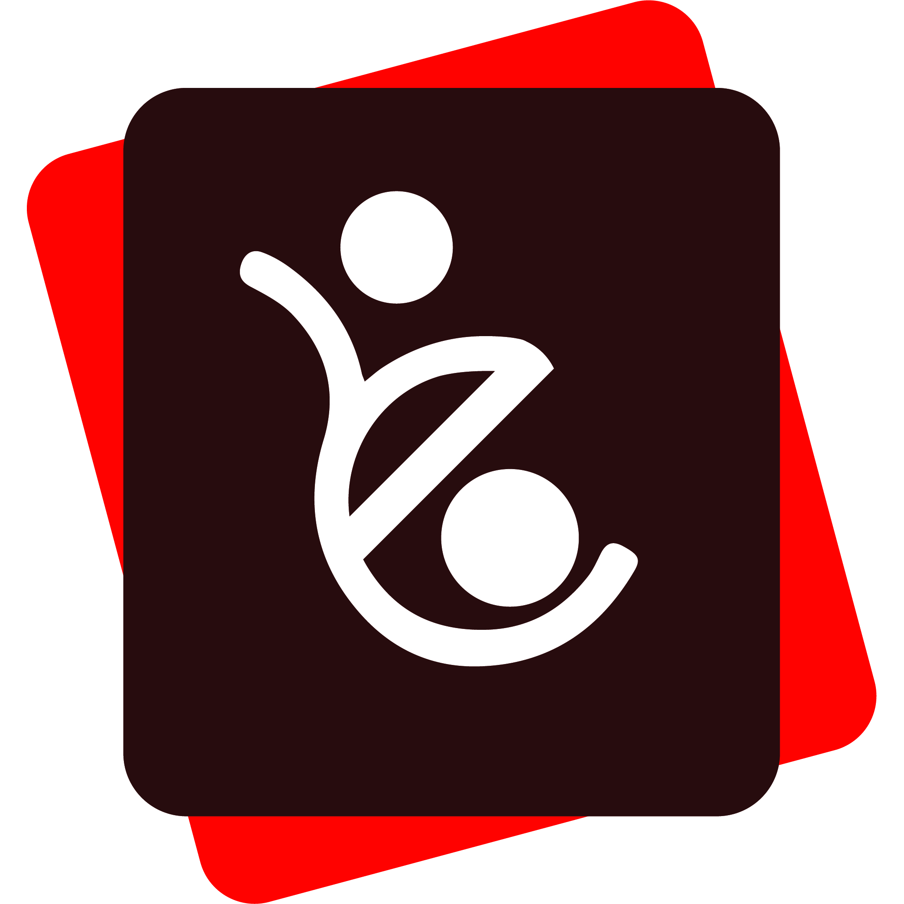

    
    <h2>thinkNXG CRM</h2>
    

        
crm made simple

    

## Key Features

-   **Views:** Create custom views which is a combination of filters, sort and columns.
    -   **Pinned View:** Pin important leads and deals in the sidebar.
    -   **Public View:** Share views with all users.
    -   **Saved View:** Save views for later use.
-   **Email Communication:** Send and receive emails directly from the Lead/Deal Page.
-   **Email Templates:** Create and use email templates for faster communication.
-   **Comments:** Add comments to leads and deals to keep track of the conversation.
-   **Notifications:** Get notified when someone mentions you in a comment.
-   **Service Level Agreement:** Set SLA for leads and deals and get notified when the SLA is breached.
-   **Assignment Rule:** Automatically assign leads and deals to users based on the criteria.
-   **Tasks:** Create tasks for leads and deals.
-   **Notes:** Add notes to leads and deals.
-   **Call Logs:** See the call logs with call details and recordings.

## License

GNU Affero General Public License v3 (see [LICENSE](LICENSE))

The thinkNXG ERP code is licensed as GNU General Public License (v3) and the Documentation is licensed as Creative Commons (CC-BY-SA-3.0) and the copyright is owned by thinkCADD Technology Corporation (thinkCADD) and Contributors.

By contributing to thinkNXG ERP, you agree that your contributions will be licensed under its GNU General Public License (v3).